# AI Hero 操作地图

**先找到你正在面对的场景，再沿流程选择技能、完成工作。** 这张地图按场景把 AI Hero 的技能串成操作流程。你可以从要解决的问题找到路线，也可以按技能名称查用法。同一技能用于多条路线时，通过链接共用详细说明。

## 场景索引

| 你正在面对的场景 | 常见问题 | 进入哪条路线 |
| --- | --- | --- |
| 开发功能或项目 | 只有想法；需求已确定；工作需要多次会话或整批推进 | [1 开发功能或项目](#1-开发功能或项目) |
| 排查与修复故障 | 功能不正常、报错、变慢；不知道原因或需要验证修复 | [2 排查与修复故障](#2-排查与修复故障) |
| 处理外部 issue 或 PR | 收到别人的问题、建议或改动，需要判断怎样接手 | [3 处理外部 issue 或 PR](#3-处理外部-issue-或-pr) |
| 评估代码结构 | 项目越来越难理解、难修改或难验证 | [4 评估代码结构，选择改进方向](#4-评估代码结构选择改进方向) |
| 复盘 AI 工作 | AI 反复找文件、漏检查、误读指令或需要人纠正 | [5 复盘 AI 工作，减少重复问题](#5-复盘-ai-工作减少重复问题) |
| 交接未完成的工作 | 换人、换工具、换目录，或暂停后要继续 | [6 交接未完成的工作](#6-交接未完成的工作) |
| 看懂解释或持续学习 | 看不懂当前解释，或想跨会话学习一个主题 | [7 看懂解释，或持续学习](#7-看懂解释或持续学习) |

可以从中途进入，不必从第一章开始：

| 你手上已有的东西或遇到的卡点 | 直接入口 |
| --- | --- |
| 有效的 Spec、tickets 和依赖关系 | [拆分任务，编写代码](#14-拆分任务编写代码) |
| 已提交的改动，准备审查或已有 review 报告 | [审查代码，验收功能](#15-审查代码验收功能) |
| 已通过验收，需要整理 PR 正文 | [PR 正文格式](#b6-pr-正文格式) |
| 缺少事实、体验证据、他人的回答或配置授权 | [补充信息与完成配置](#补充信息与完成配置) |
| 第一次使用，还没有配置仓库 | [安装与配置](#附录-a-安装与配置) |
| 已知道技能名称，只想查用途和所在路线 | [27 项技能索引](#技能索引) |

还不知道从哪里开始时，可以用 `/ask-matt` 推荐下一步。它只推荐入口，不执行后续技能。[Ask-matt](https://www.aihero.dev/skills-ask-matt)

**核心工作场景怎样连接**

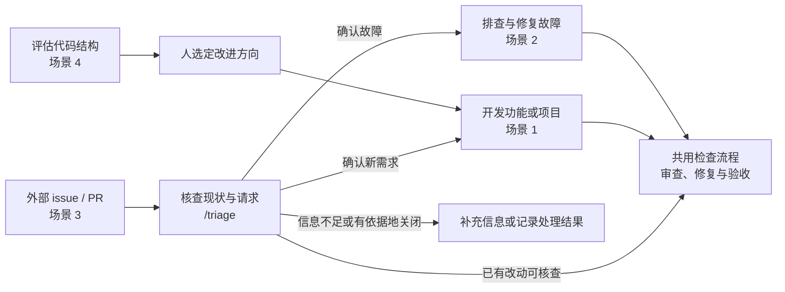

场景 5–7 分别用于改善 AI 工作中的重复问题、交接工作，以及理解解释或学习主题，按需要选择。缺少资料、体验证据、他人的回答或配置授权时，先用[共用工具](#补充信息与完成配置)补齐，再回到当前场景。

## 1 开发功能或项目

无论是从想法开始，还是已有方案、准备写代码，都可以使用这条路线。先在总览图中找到当前阶段，再查看对应的局部流程。

### 1.1 开发流程总览

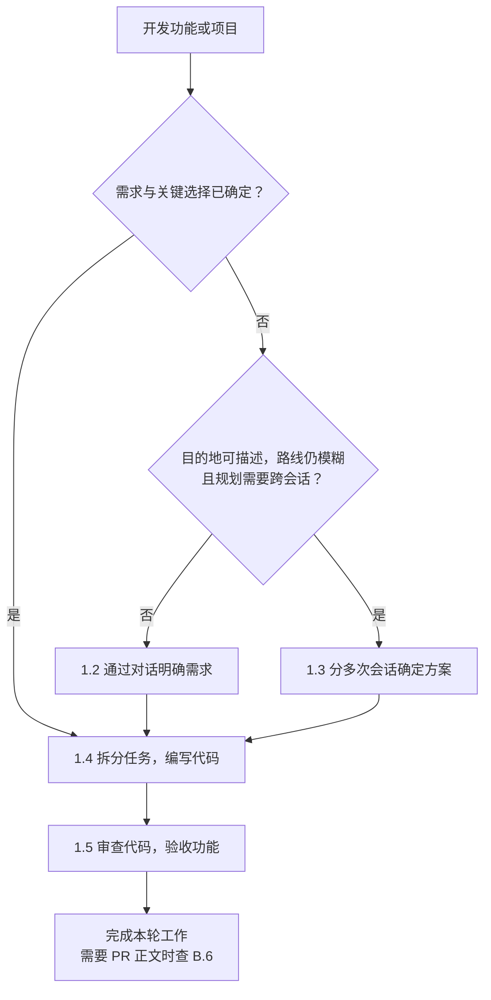

这里的“已确定”，指目标、范围、关键选择和验收方式已经明确。**规划是否跨会话**，决定是否需要逐步寻找路线；**实施是否跨会话**，决定是否需要整理 Spec 和拆分 tickets。具体判断见 [1.3](#13-分多次会话确定方案) 和 [1.4](#14-拆分任务编写代码)。

已有有效 Spec、tickets 和依赖关系时，直接进入 [1.4](#14-拆分任务编写代码)；已有可审查的提交时，直接进入 [1.5](#15-审查代码验收功能)。

### 1.2 把需求与关键选择谈清楚

用 `/grill-with-docs` 逐步追问，把使用者、范围、取舍和验收方式谈清楚，直到影响实施方向的关键选择得到确认。[Grill-with-docs](https://www.aihero.dev/skills-grill-with-docs)

| 当前情况 | 入口 | 配合方法与记录 |
| --- | --- | --- |
| 已有仓库，需要结合现有代码讨论 | `/grill-with-docs` | `grilling` 追问选择；`domain-modeling` 统一领域用词 |
| 尚无仓库，或讨论非代码想法 | `/grill-me` | 使用 `grilling` 把想法和计划谈清楚 |

稳定的领域词汇写入 `GLOSSARY.md`；较重要、确有取舍的决定可能记录为 ADR。普通选择可能只记录在会话中；如果实施需要跨会话，要先整理成 Spec。[Grill-me](https://www.aihero.dev/skills-grill-me)

```text
/grill-with-docs
我们要在团队报表页增加 CSV 导出。请先厘清用户、权限、数据范围、失败情况和验收方式；我回答关键取舍后再进入实现。
```

有些事情还不清楚、讨论无法继续时，先用[共用工具](#补充信息与完成配置)获得所需资料、体验证据或他人的回答，再继续作出选择。

**进入下一步的条件：** 使用者、范围、必须成立的行为和验收方式已明确；不做什么已说清；关键选择已确认，其余待查事实和待确认事项已记录。

### 1.3 分多次会话确定方案

能描述目的地，但路线和关键选择仍不清楚，而且规划本身需要多个会话时，用 `/wayfinder` 逐步确定方案。每个 **decision ticket** 记录一个问题及其结论，主地图把这些记录联系起来。[Wayfinder](https://www.aihero.dev/skills-wayfinder)

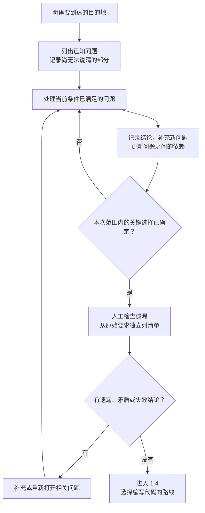

以 CSV 导出为例：如果还没确定字段范围、普通成员的权限，或导出十万行结果时怎样等待，可把目的地写成“确定一份团队可实施的 CSV 导出 Spec”。需要补充依据时，使用[共用工具](#补充信息与完成配置)。

地图中的 `task` 只用于解除作出选择前的阻碍。四种 ticket 类型、记录规则及人工遗漏检查见 [B.1](#b1-wayfinder-记录与遗漏检查)。

**本节的结果：** 关键选择已有结论，遗漏检查已完成。接下来进入 [1.4](#14-拆分任务编写代码)；实施跨会话时，将**主地图**交给 `/to-spec #<map_issue>`。已确定、一次会话可以完成的任务，可直接实施。

### 1.4 拆分任务，编写代码

需求和关键选择确定后，按下图选择执行方式。小任务可以直接开始；已有可用的任务安排时，也可以跳过整理和拆分。

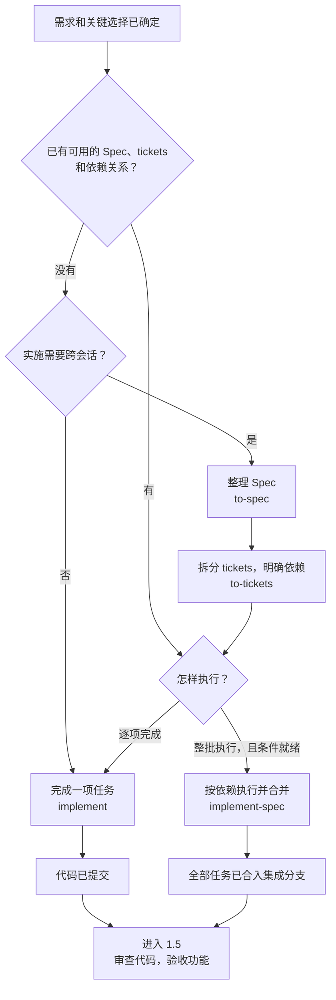

**四项技能怎样配合：**

| 技能 | 输入 | 做什么 | 产物 |
| --- | --- | --- | --- |
| [`to-spec`](https://www.aihero.dev/skills-to-spec) | 已确认的需求与选择 | 整理目标、范围、约束和测试边界 | Spec |
| [`to-tickets`](https://www.aihero.dev/skills-to-tickets) | Spec | 拆分可独立演示、验证的小任务，明确依赖 | tickets 与任务图 |
| [`implement`](https://www.aihero.dev/skills-implement) | 一项 ticket 或小 Spec | 编写代码、运行检查、提交到当前分支 | 已提交的改动 |
| [`implement-spec`](https://www.aihero.dev/skills-implement-spec) | Spec、tickets 与就绪的运行条件 | 按依赖安排实施，再合入集成分支 | 全部任务合入的集成分支 |

`to-spec` 不重新访谈，也不替人作新选择；它整理出的 Spec 不能证明上游方案完整。整理前先确认怎样测试、哪些内容不在本次范围；如果仍有决定实施方向的问题，回到 [1.2](#12-把需求与关键选择谈清楚)。

**CSV 导出示例：从需求到可验收任务**

下面用 CSV 导出说明怎样拆分任务。假设以下要求已经确认：管理员导出当前筛选结果，普通成员受团队权限限制，大量结果采用异步下载。先把字段范围、权限、等待方式和验收条件整理进 Spec，再拆成完整的小功能。

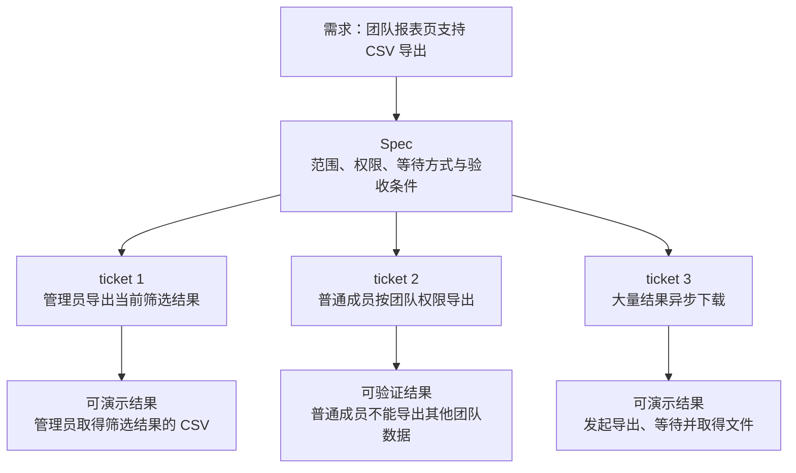

每项 ticket 都应有从入口到结果的完整路径。只完成数据库层或接口层、无法独立演示和验收的任务，通常需要重新拆分。这三项任务的先后顺序及能否并行，要按实际依赖另行确认。

**两条执行路线的检查与限制：**

| 路线 | 自带检查 | 人仍需确认什么 |
| --- | --- | --- |
| `implement` | 运行检查、调用 `code-review`，然后提交 | 内置审查看不到尚未提交的代码；不自动修复发现，也不能可靠地勾选验收项或关闭 ticket |
| `implement-spec` | 全部任务合入后审查整支代码，再安排修复 | 没有完整的修复后停止规则；修复验证、复审、验收和任务状态仍需核对 |

执行前给出完整的 issue URL 或明确的文件路径，核对任务标题、验收条件和当前分支。整批执行的准备与调度见 [B.3](#b3-整批执行的准备与调度)，需要行为测试时见 [B.4](#b4-行为测试与验证范围)，可复制提示词见 [B.5](#b5-可复制提示词)。[当前 Implement 源文件](https://github.com/mattpocock/skills/blob/49dd158d1076134a641b33efb035946536778336/skills/engineering/implement/SKILL.md)

**进入下一步的条件：** 逐项执行的代码已提交，或整批执行的全部任务已合入集成分支。接下来进入 [1.5](#15-审查代码验收功能)。

### 1.5 审查代码，验收功能

本轮代码提交后，按“审查 → 核实与修复 → 验收”检查结果。整批执行时，先确认所有任务已合入集成分支，避免把后续任务判为缺失要求。已有 PR 时，确认当前分支与 `HEAD` 对应待审改动。开发、故障修复和 PR 都可以使用这条流程。

已有对应本轮改动的审查报告时，可以从图中的“核实发现及证据”继续。

`/code-review` 分别检查 Standards（仓库规范）与 Spec（原规格）。审查前给出明确、可解析的固定基点，最好在独立的新会话中运行。[Code-review](https://www.aihero.dev/skills-code-review)

```text
/code-review main
请按本次功能的规格核对，并把每条发现对应到代码位置或规格条款。
```

**审查只比较 `<基点>...HEAD`，看不到未提交改动。** 审查器找不到规格时会跳过 Spec 轴；必要时明确提供规格 issue 或文件路径，不能把跳过当成通过。

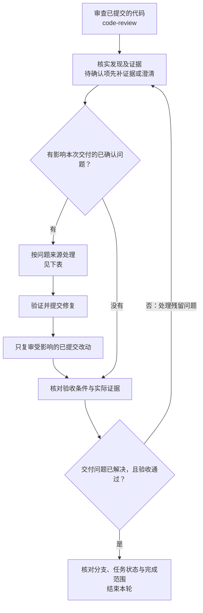

| 核实后的情况 | 怎样处理 | 需要留下什么 |
| --- | --- | --- |
| 代码错误 | 修复代码与必要测试；根因不明时先用 `diagnosing-bugs` | 测试与实际行为通过，修复提交进入复审范围 |
| Spec 缺口 | 用 `grill-with-docs` 澄清，更新 Spec 与受影响的 tickets，再修改代码 | 新决定与验证方式 |
| 原选择失效 | 回到原来的规划流程；用了 Wayfinder 时同步更新地图，再更新 Spec 与任务 | 更正后的选择及依据 |
| 待确认 | 补证据或澄清后，再次核实 | 新证据与判断 |
| 成立，但不影响本次交付 | 留到后续处理 | 可追踪任务与本次不处理的理由 |
| 误报或未采纳的风格意见 | 记录不采纳依据 | 对应代码或仓库规范 |

例如，普通成员能导出其他团队数据，是代码错误；“撤销权限后已有下载链接是否仍可用”从未决定，则应先澄清并更新 Spec。

```text
请逐条核实这份 code-review 报告：<报告或会话链接>。
对每条写明代码/规范/规格证据及“成立、不成立、待确认”。
直接修复已确认且范围明确的实现问题，并运行相关验证；规格缺口和需要改变原决策的问题，请指出受影响的Spec、任务和原选择，先完成澄清再实施。
修复提交后只复审受影响的已提交改动，最后核对验收条件和任务状态。
```

**完成条件：** 影响交付的问题已解决，验收通过，测试、实际行为和复审证据已保留。逐项核对约定的行为、当前分支、任务状态和本次完成范围。“没有审查意见”不能代替验收。

修复后针对改动验证、复审并核对验收，是本地图补充的检查步骤。

## 2 排查与修复故障

功能不正常、报错或变慢时，先找到能快速、稳定复现问题的检查方法，再验证原因和修复效果。调用 `/diagnosing-bugs` 时，说明实际症状、复现方式和期望行为。[Diagnosing-bugs](https://www.aihero.dev/skills-diagnosing-bugs)

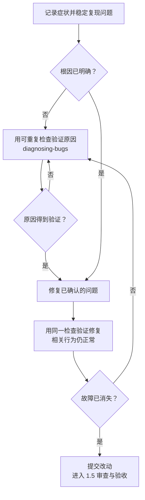

测试、运行脚本或可重复操作都可以用来判断成败；只看代码、猜测原因，不能证明问题已解决。需要行为测试时，参考 [B.4](#b4-行为测试与验证范围)；发现需求或原选择不完整时，回到 [1.2](#12-把需求与关键选择谈清楚)。

**本节的结果：** 同一检查能证明修复前存在故障、修复后故障已消失，相关行为也已验证。提交改动后，继续按 [1.5](#15-审查代码验收功能)审查与验收；如果会话中暴露出反复发生的工作环境问题，按需进入[场景 5](#5-复盘-ai-工作减少重复问题)。

## 3 处理外部 issue 或 PR

收到别人提交的问题、建议或改动时，用 `/triage` 核对请求与代码现状，再决定补充信息、关闭请求，或进入相应的工作路线。可以指定要查看的 issue／PR，也可以让它列出待处理的 issue 或 PR。`/to-tickets` 新建的实施任务无需再经过 triage。[Triage](https://www.aihero.dev/skills-triage)

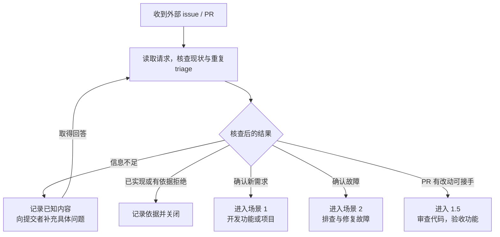

检查 issue 时，核对实际问题和已有实现；检查 PR 时，还要核查改动是否实现了所述行为。确认可以接手后，明确由 AI 还是人处理。在 triage 中发布内容时，按技能要求注明由 AI 生成；处理结果由维护者确认。

**本节的结果：** 待处理事项已有明确去向和处理依据。需要开发、修复或 PR 审查时，继续进入对应路线；PR 的审查输入要求见 [1.5](#15-审查代码验收功能)。

## 4 评估代码结构，选择改进方向

如果理解一个功能需要来回翻阅很多文件，或修改牵动过多地方，或代码难以测试，可以用 `/improve-codebase-architecture` 评估哪些部分值得改进。可以指定模块或目前最难改的地方。[Architecture](https://www.aihero.dev/skills-improve-codebase-architecture)

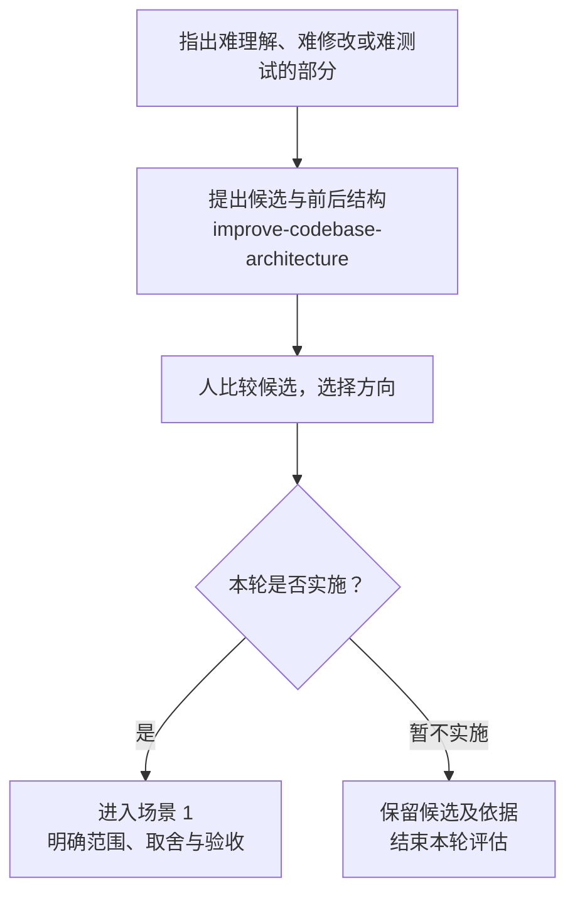

候选应说明哪里难改、怎样调整、预期改善什么。`codebase-design` 提供模块、接口和测试边界等判断方法。[Codebase-design](https://www.aihero.dev/skills-codebase-design)

**本节的结果：** 候选有依据，本轮选择已明确。选定的改进由[开发流程](#1-开发功能或项目)完成实际修改与验收。

## 5 复盘 AI 工作，减少重复问题

AI 反复找文件、漏检查或误读指令时，可以复盘真实会话；已经明确的指令问题，也可以直接处理。当前软件故障仍通过[场景 2](#2-排查与修复故障)修复。

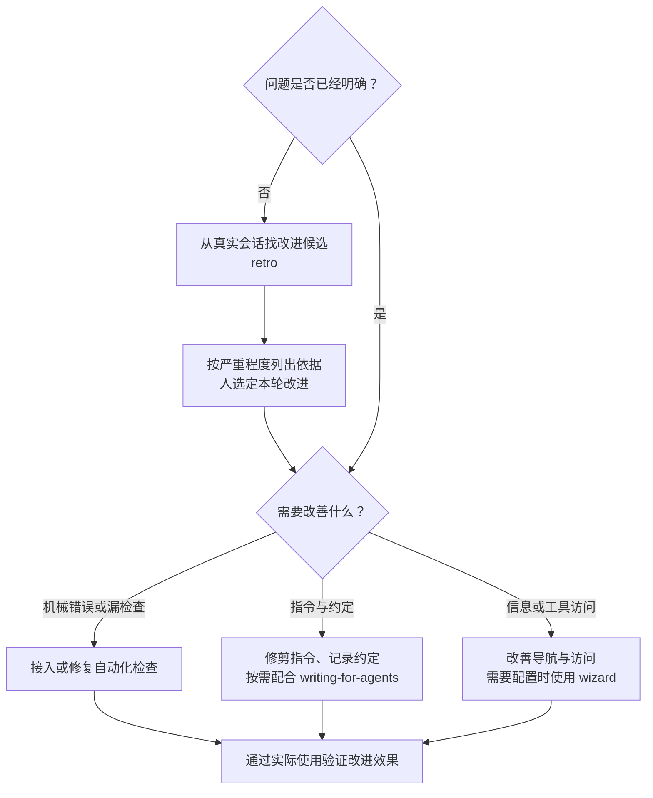

困难会话结束或顽固缺陷处理完成后，可以用 `/retro` 回看当前或指定的会话记录，检查导航、自动化检查、编码规范、全局指令、工具成本、无效指令和信息可达性。由人选定要采用的建议后，再作修改。[Retro](https://www.aihero.dev/skills-retro)

```text
/retro
请复盘 <当前或指定会话>。每项建议都给出会话中发生的具体问题，优先检查已有自动化检查是否未接入；先按严重程度给候选列表，等我选定后再实施。
```

| 问题 | 改进办法 |
| --- | --- |
| 机械错误、漏检查 | 优先接入 lint、类型、测试、hook 或 CI；已有检查未接入时先接好 |
| 需要判断的代码约定 | 写入 `CODING_STANDARDS.md` |
| AGENTS.md、技能或 agent 可读规格有重复、无效指令 | 用 `writing-for-agents` 修剪，再通过实际使用验证 |
| 找不到信息，或工具缺少授权配置 | 改善导航和访问；需要配置向导时见[共用工具](#补充信息与完成配置) |

[Writing-for-agents](https://www.aihero.dev/skills-writing-for-agents) 用于改善 AI 读取的指令。复盘不会自动变成一直添加规则的无人值守循环。

**完成条件：** 选定改进已实施，并有实际使用证据；涉及软件改动时，接回[场景 1](#1-开发功能或项目)。

## 6 交接未完成的工作

换人、换工具、换目录，或长期暂停后需要继续工作时，用 `/handoff` 整理必要的上下文，说明下一次会话要继续什么。同一会话中继续工作时，直接回到当前任务。[Handoff](https://www.aihero.dev/skills-handoff)

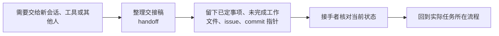

| 交接者留下什么 | 接手者要能确认什么 |
| --- | --- |
| 已定事项及 Spec、记录链接 | 哪些选择已经确定 |
| 未完成工作与下一步 | 从哪个阶段继续 |
| 文件、issue、commit 指针 | 到哪里核对当前状态 |

交接稿以稳定的文件、issue 和 commit 引用为主，通过链接指向已有资料。**完成条件：** 接手者能找到有效资料，知道哪些事项还没完成、下一步做什么。

## 7 看懂解释，或持续学习

看不懂当前解释，或希望跨会话学习一个主题时，按目标选择下面的路线。

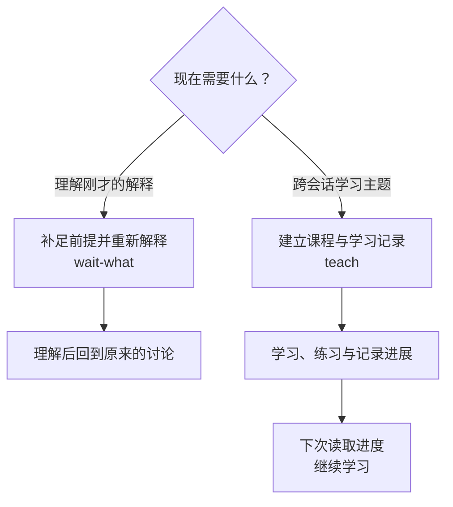

| 目标 | 怎样开始 | 本次结果 |
| --- | --- | --- |
| 看懂当前解释 | 用 `/wait-what` 指出哪里没理解 | 理解后继续原讨论 |
| 持续学习一个主题 | 在独立学习目录用 `/teach` 说明主题 | 本次学习完成，留下可接续的课程与进度 |

[Wait-what](https://www.aihero.dev/skills-wait-what) 与 [Teach](https://www.aihero.dev/skills-teach) 按目标选择；长期学习时，沿用独立的课程目录和记录继续。

## 补充信息与完成配置

无论在哪个场景，遇到尚未查清的事情，都可以从这里选择工具。获得结果后回到原来的讨论或工作流程；需要人作选择时，由人确认。

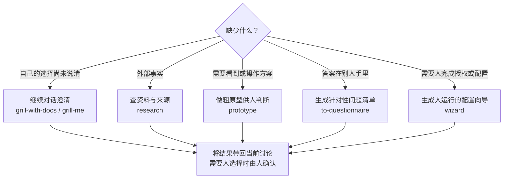

| 缺少什么 | 工具 | 得到什么及使用边界 |
| --- | --- | --- |
| 外部事实 | [research](https://www.aihero.dev/skills-research) | 事实与来源，供当前选择使用 |
| 体验证据 | [prototype](https://www.aihero.dev/skills-prototype) | 供人判断的粗原型 |
| 特定人的回答 | [to-questionnaire](https://www.aihero.dev/skills-to-questionnaire) | 针对性问题清单，只生成、不发送 |
| 授权或配置操作 | [wizard](https://www.aihero.dev/skills-wizard) | 人运行的向导，用于网页授权、复制密钥、设置 CI 等 |

这些工具提供依据或协助完成配置，不自动替人作选择。自己的需求和取舍尚未说清时，回到[需求澄清](#12-把需求与关键选择谈清楚)。

## 技能索引

按技能名称查用途、适用场景和详细说明。入口工作流用来启动任务，配合方法与工具可由 AI 在相关节点加载。能否直接调用取决于运行工具，不必逐项运行。

| 技能 | 用途 | 适用场景 | 说明位置 |
| --- | --- | --- | --- |
| [`ask-matt`](https://www.aihero.dev/skills-ask-matt) | 推荐下一步入口 | 任意场景，不知道入口时 | [场景索引](#场景索引) |
| [`code-review`](https://www.aihero.dev/skills-code-review) | 对照规范与 Spec 审查已提交改动 | 开发、故障、外部 PR | [审查代码，验收功能](#15-审查代码验收功能) |
| [`codebase-design`](https://www.aihero.dev/skills-codebase-design) | 配合方法：判断模块、接口与测试边界 | 代码结构；开发中的结构判断 | [代码结构的配合方法](#4-评估代码结构选择改进方向) |
| [`diagnosing-bugs`](https://www.aihero.dev/skills-diagnosing-bugs) | 用可重复反馈验证原因与修复 | 故障；来件确认的 bug | [故障](#2-排查与修复故障) |
| [`domain-modeling`](https://www.aihero.dev/skills-domain-modeling) | 配合方法：维护领域词汇与必要的 ADR | 开发、外部来件、结构改进中的澄清 | [澄清需求的配合方法](#12-把需求与关键选择谈清楚) |
| [`grill-me`](https://www.aihero.dev/skills-grill-me) | 澄清无仓库或非代码想法 | 无仓库或非代码想法 | [开发的澄清入口](#12-把需求与关键选择谈清楚) |
| [`grill-with-docs`](https://www.aihero.dev/skills-grill-with-docs) | 在仓库中澄清需求与关键选择 | 开发；其他场景转来的需求 | [开发](#12-把需求与关键选择谈清楚) |
| [`grilling`](https://www.aihero.dev/skills-grilling) | 配合方法：追问目标、选择与取舍 | 开发、外部来件、结构改进中的澄清 | [澄清需求的配合方法](#12-把需求与关键选择谈清楚) |
| [`handoff`](https://www.aihero.dev/skills-handoff) | 为接手者整理必要上下文与指针 | 任意场景，需要接手时 | [交接未完成的工作](#6-交接未完成的工作) |
| [`implement`](https://www.aihero.dev/skills-implement) | 实现一项已确定的任务或小 Spec | 开发；明确的故障修复 | [逐项编写代码及使用限制](#14-拆分任务编写代码) |
| [`implement-spec`](https://www.aihero.dev/skills-implement-spec) | 按依赖编排整份 Spec 的实施与集成 | 开发，有完整安排与运行条件时 | [整批编写代码及使用限制](#14-拆分任务编写代码) |
| [`improve-codebase-architecture`](https://www.aihero.dev/skills-improve-codebase-architecture) | 提出有依据的结构改进候选 | 代码结构 | [代码结构](#4-评估代码结构选择改进方向) |
| [`pr`](https://www.aihero.dev/skills-pr) | 组织 PR 正文 | 开发、故障、外部 PR 的正文 | [PR 正文格式与用法](#b6-pr-正文格式) |
| [`prototype`](https://www.aihero.dev/skills-prototype) | 信息或配置支持：做供人判断的粗原型 | 开发或结构改进，需要体验证据时 | [需要体验证据的节点](#补充信息与完成配置) |
| [`research`](https://www.aihero.dev/skills-research) | 信息或配置支持：查外部事实并保存来源 | 开发、故障或结构改进，缺外部事实时 | [缺少事实的节点](#补充信息与完成配置) |
| [`retro`](https://www.aihero.dev/skills-retro) | 从真实会话提出环境改进 | AI 工作复盘 | [复盘与已知问题的改进](#5-复盘-ai-工作减少重复问题) |
| [`setup-matt-pocock-skills`](https://www.aihero.dev/skills-setup-matt-pocock-skills) | 配置仓库、tracker 与文档位置 | 首次准备或重新配置仓库 | [首次准备](#附录-a-安装与配置) |
| [`tdd`](https://www.aihero.dev/skills-tdd) | 配合方法：按约定行为逐个推进 red → green | 开发、故障，需要行为测试时 | [开发与故障的配合方法](#b4-行为测试与验证范围) |
| [`teach`](https://www.aihero.dev/skills-teach) | 建立跨会话课程和学习记录 | 持续学习 | [学习](#7-看懂解释或持续学习) |
| [`to-questionnaire`](https://www.aihero.dev/skills-to-questionnaire) | 信息或配置支持：生成给特定人的问题清单 | 任意场景，需要别人提供信息时 | [需要别人回答的节点](#补充信息与完成配置) |
| [`to-spec`](https://www.aihero.dev/skills-to-spec) | 将已定需求与选择整理为 Spec | 实施跨会话的开发 | [整理 Spec 与拆分任务](#14-拆分任务编写代码) |
| [`to-tickets`](https://www.aihero.dev/skills-to-tickets) | 拆出可独立验收的任务与依赖 | 实施跨会话的开发 | [整理 Spec 与拆分任务](#14-拆分任务编写代码) |
| [`triage`](https://www.aihero.dev/skills-triage) | 核查并处理外部请求 | 外部 issue 或 PR | [外部 issue 或 PR](#3-处理外部-issue-或-pr) |
| [`wait-what`](https://www.aihero.dev/skills-wait-what) | 补足前提并重新解释 | 任意场景，当前解释没理解时 | [理解当前解释](#7-看懂解释或持续学习) |
| [`wayfinder`](https://www.aihero.dev/skills-wayfinder) | 在跨会话规划中逐步确定路线 | 开发，路线模糊且规划跨会话时 | [开发的规划路线](#13-分多次会话确定方案) |
| [`wizard`](https://www.aihero.dev/skills-wizard) | 信息或配置支持：生成人运行的授权或配置向导 | 开发、AI 工作环境中的人工配置 | [需要人工配置的节点](#补充信息与完成配置) |
| [`writing-for-agents`](https://www.aihero.dev/skills-writing-for-agents) | 配合方法：修剪并验证 AI 使用的指令 | AI 工作复盘；编写供 AI 读取的资料时 | [指令改进的方法](#5-复盘-ai-工作减少重复问题) |

## 附录 A 安装与配置

每个 agent 只选一种安装方式，避免安装两份同名技能。原生插件适合托管使用；需要编辑技能文件时，用通用 skills CLI。具体命令及更新方式见[仓库 README](https://github.com/mattpocock/skills/blob/49dd158d1076134a641b33efb035946536778336/README.md)。

**Codex 原生插件**，README 说明会在启动时更新：

```bash
codex plugin marketplace add mattpocock/skills
codex plugin add mattpocock-skills@mattpocock
```

**Claude Code 插件**：

```bash
claude plugin install mattpocock-skills@claude-plugins-official
```

**可编辑的技能文件**，运行后选择技能和 agent：

```bash
npx skills@latest add mattpocock/skills
```

安装后，在仓库中运行 `/setup-matt-pocock-skills`，配置 issue tracker、标签和领域文档位置。配置保存为仓库文档，由 agent 指令文件引用；没有远端 tracker 时，可用本地 Markdown。[配置说明](https://github.com/mattpocock/skills/blob/49dd158d1076134a641b33efb035946536778336/skills/engineering/setup-matt-pocock-skills/SKILL.md)

开始前确认仓库、分支、测试命令和 tracker 配置。首次试用可选一项小任务，看看结果是否符合团队习惯。

## 附录 B 关键检查与速查

| 想查什么 | 位置 |
| --- | --- |
| Wayfinder 的记录类型和人工遗漏检查 | [B.1](#b1-wayfinder-记录与遗漏检查) |
| 怎样区分任务归属与执行顺序 | [B.2](#b2-任务归属与依赖) |
| 整批执行要准备什么、怎样调度 | [B.3](#b3-整批执行的准备与调度) |
| 怎样确定行为测试的范围 | [B.4](#b4-行为测试与验证范围) |
| 四项实施技能的可复制提示词 | [B.5](#b5-可复制提示词) |
| PR 正文的结构与示例 | [B.6](#b6-pr-正文格式) |
| 常用产物与术语的含义 | [B.7](#b7-常用产物与术语) |

### B.1 Wayfinder 记录与遗漏检查

主地图只作索引，decision tickets 作为子 issue 保存问题、结论与依据。四种类型各有用途：

| 类型 | 用途 |
| --- | --- |
| `grilling` | 通过对话作出选择 |
| `prototype` | 用粗原型帮助人判断 |
| `research` | 查清选择所需的外部事实 |
| `task` | 完成作出选择前必须做的操作 |

这些记录用于明确方案，实施任务另行拆分。标签、创建顺序和记录格式见 [Wayfinder 规则](https://github.com/mattpocock/skills/blob/49dd158d1076134a641b33efb035946536778336/skills/engineering/wayfinder/SKILL.md)。

**遗漏检查是手册补充的人工步骤，没有对应的官方独立技能或命令。** 先从原始需求、角色、场景和约束独立列出清单，再核对地图；只复查现有子 issue，可能仍会漏掉尚未发现的问题。

| 检查项 | 要确认什么 |
| --- | --- |
| 目标与验收 | 每项都能追溯到决策及依据 |
| 角色与场景 | 主要角色、正常、异常和边界场景都有覆盖 |
| 项目约束 | 权限、数据、性能和运维等相关约束已经落实 |
| 依赖 | 阻塞关系真实，没有循环 |
| 已关闭事项 | 有明确结论及必要的人类确认，没有无依据地关闭或错误地排除在范围外 |
| 新事实 | 没有尚未处理的失效决策；被推翻的决定已经重评 |

可复制下面的提示词进行检查：

```text
请检查这张 Wayfinder 主地图及所有子 issue：<主地图 URL>。
从原始目标、角色、场景和约束独立列出事项，输出“事项 → decision ticket → 证据 → 状态 → 缺口与动作”表。
检查依赖、已关闭事项、范围外事项和被新事实推翻的决定，区分确认遗漏与推测风险。指出需新增或重开的 issue；先报告结果，不代替人作选择。
```

检查通过后，回到 [1.4](#14-拆分任务编写代码)选择执行方式。

### B.2 任务归属与依赖

“任务属于哪一组”和“哪项任务必须先完成”，是两种不同的关系：

| 关系 | 何时建立 | 如何记录 |
| --- | --- | --- |
| 父子关系 | 规格来自既有 issue | 新 ticket 成为它的原生子 issue |
| 阻塞关系 | 必须先完成某项任务，另一项任务才能开始 | 建立原生阻塞边；父子关系不代替阻塞关系 |

优先使用 tracker 的原生关系，不支持时才改用正文约定；本地 Markdown 在每项任务文件中写明依赖。具体记录方式见 [To-tickets 说明](https://github.com/mattpocock/skills/blob/49dd158d1076134a641b33efb035946536778336/skills/engineering/to-tickets/SKILL.md)。

验收条件应能区分实施前后的结果：实施前不通过，实施后通过。

### B.3 整批执行的准备与调度

前置任务的改动已合入集成分支后，下游任务即可开始，无需等待 GitHub issue 关闭。整批调度方式如下：

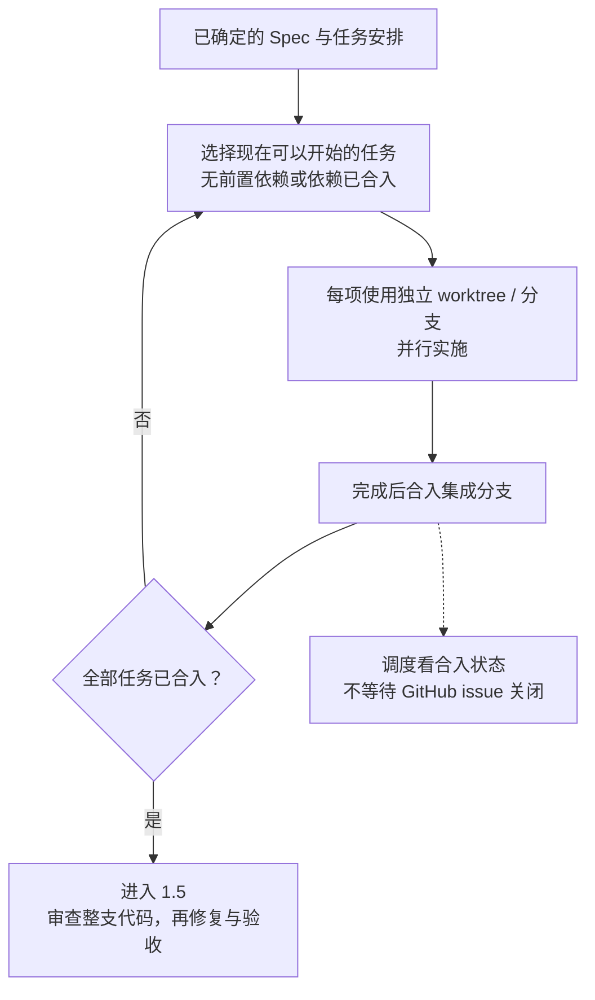

执行前检查：

| 项目 | 必须准备好什么 |
| --- | --- |
| 任务图 | Spec、可独立验收的任务和真实依赖已经确定 |
| 测试边界 | 提前写进 Spec 和任务，并行执行不会逐项与你确认 |
| 运行环境 | 当前工具支持所需的并行执行与独立 worktree，tracker 已配置 |
| 共享修改 | 先确定共享名称，必要时增加真实依赖，避免共享文件或字段冲突 |
| 测试资料 | 未被 Git 跟踪的夹具或数据库，需明确在哪个环境验证 |

若 tracker 通过 PR 关闭工作，或人明确要求 PR，首次合并后创建草稿 PR，结束时标为可审；否则按 tracker 的约定处理任务状态并报告分支。

完整运行要求与调度规则见 [Implement-spec 说明](https://github.com/mattpocock/skills/blob/49dd158d1076134a641b33efb035946536778336/skills/engineering/implement-spec/SKILL.md)。

### B.4 行为测试与验证范围

需要行为测试时，`/tdd` 从已商定的外部可观察边界入手，每次推进一个 red → green 切片。重构留给审查阶段。当前仓库版要求说明每个候选边界“能捕获什么、遗漏什么”。某一层测试通过，不代表全部行为已验证，也不能代替对需求正确性的判断。[当前 TDD 源文件](https://github.com/mattpocock/skills/blob/49dd158d1076134a641b33efb035946536778336/skills/engineering/tdd/SKILL.md)

### B.5 可复制提示词

下面的提示词分别对应 [1.4](#14-拆分任务编写代码)中的四项技能，按当前阶段选择。

#### to-spec

```text
/to-spec
请把刚才已确认的决策写成规格。如果发现仍有决定实施方向的关键问题，请指出并先返回澄清，不要在规格中替我选择。
```

#### to-tickets

```text
/to-tickets #<spec_issue>
发布前先给我看每项任务的演示路径、验收条件和阻塞关系。
```

#### implement

```text
/implement https://github.com/<owner>/<repo>/issues/<number>
请先复述任务的标题、验收条件和当前分支，再按这一项任务的范围实施。
```

#### implement-spec

```text
/implement-spec <完整规格 issue URL 或文件路径>
按已确认的任务图实施。请先核对阻塞关系、共享接口名称和测试边界；全部任务进入集成分支后再做整支审查，修复后做针对性验证。
```

### B.6 PR 正文格式

需要写 PR 正文时，用 `/pr` 的三部分格式；已有仓库模板时，先决定怎样把这三部分放进模板。[PR](https://www.aihero.dev/skills-pr)

| 部分 | 要回答的问题 |
| --- | --- |
| Summary | 改了什么？用最小的图、伪代码或结构示意说明 |
| Evidence | 改动前后如何验证？给出实际证据 |
| Merge Danger | 能否撤回？影响范围是什么？ |

```text
/pr
请根据 <已审查分支> 与 <规格引用> 撰写 PR 正文，给出最小改动示意、实际验证证据、可逆性和影响范围，并遵循仓库现有模板。
```

`/pr` 只规定正文格式；推送分支、创建 PR 和处理审查评论仍需另行操作。

### B.7 常用产物与术语

| 产物 | 保存什么及使用边界 |
| --- | --- |
| `GLOSSARY.md` | 稳定领域词汇与概念，不存全部聊天或规格全文 |
| ADR | 记录难逆、缺上下文易误解且确有取舍的决定，不为每个小选择单独写一篇 |
| Wayfinder 主 map | 索引目的地、决策、未决问题和范围外事项，不重复存完整答案 |
| decision ticket | 保存一个需要回答的问题及决议证据，不写成产品实施任务 |
| Spec | 保存当期已确认的范围、决定和测试边界，不永久同步所有代码变化 |
| ticket | 一项从入口到结果完整、可独立演示和验证的实施任务 |
| Prototype / Research | 提供选择依据；原型保留在不合并的证据分支，不由 agent 替人决定 |
| Handoff | 保存下一会话所需的稳定指针和未完成事项，不充当长期唯一事实来源 |

更多术语见官方 [AI Coding Dictionary](https://www.aihero.dev/ai-coding-dictionary)。

## 附录 C 版本与学习资料

本手册对应 Skills [v1.3.1](https://github.com/mattpocock/skills/releases/tag/v1.3.1)，含[后续仓库更新](https://github.com/mattpocock/skills/commit/49dd158d1076134a641b33efb035946536778336)。

| 资料 | 适合学什么 |
| --- | --- |
| [The AI Engineer Roadmap](https://www.aihero.dev/ai-engineer-roadmap) | 了解 AI 产品开发的学习路线与效果评估方法 |
| [LLM Fundamentals](https://www.aihero.dev/llm-fundamentals) | 理解消息、token、上下文、工具与 agent |
| [AI SDK v6 Crash Course](https://www.aihero.dev/workshops/ai-sdk-v6-crash-course) | 用 TypeScript 学习模型调用、流式输出与工具使用 |
| [AI Coding Dictionary](https://www.aihero.dev/ai-coding-dictionary) | 查阅 AI 编程中的术语与工作方式 |
